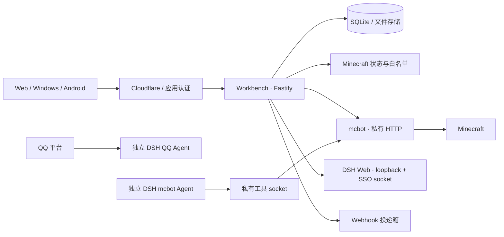

# 架构

AntifieldComplexx 由 Workbench、客户端、Minecraft Bot 和三个隔离的 DSH Agent 环境组成。当前 schema 22，mcbot 契约 v2；版本期望见 `deploy/tool-versions.json`，运行指针见 [ACCEPTANCE](ACCEPTANCE.md)。

## 1. 进程与数据流

- Workbench 是 Node 原生 TypeScript/Fastify 单进程；入口 `apps/workbench/server/src/main.ts`，托管客户端构建产物，不编译服务端源码。
- React/Vite 源码在 `apps/client`，产物在 `apps/workbench/web/dist`。Tauri 容器负责设备密钥、签名认证传输、系统选择器、隔离 AI 窗口与平台生命周期。
- DSH Web、QQ、mcbot Agent 各有账号、Home、目录、凭据和会话。Web 不装 Minecraft 动作工具，不建立第二条 QQ 入站；两个只显示插件提供独立服务说明。
- mcbot 拥有动作、任务、阈值、世界记忆和执行权。DSH 插件只转发私有 socket 工具调用，不能绕过 Bot 的白名单和安全检查。
- 备份、主机状态和受限 root 动作由脚本/systemd 管理，应用只读状态文件。应用不承担 Minecraft 启停、任意 RCON 或主机命令执行。

## 2. 服务端模块

| 路径（相对 `apps/workbench/server/src`） | 职责 |
|---|---|
| `main.ts`、`app.ts`、`config.ts` | 配置校验、服务装配、启动和退出 |
| `db.ts`、`auth/` | SQLite 迁移、会话、TOTP、设备签名、CSRF、限流和审计 |
| `files/`、`uploads/` | 不可变文件、配额、origin 可见性、分片与拼接 |
| `notes/`、`shares/` | 知识库、附件/版本、分享解锁与名额预占 |
| `mc/` | 服务器状态、固定 RCON 查询与白名单 |
| `mcbot/` | 私有 HTTP 客户端、状态轮询、内存事件、告警游标和管理员对话代理 |
| `opencode/` | DSH Web 反代的兼容目录名，负责 Host/Origin、SSO、HTTP/WS 和插件页路径限制 |
| `alerts/` | 条件状态机、外部事件记录、webhook 持久化投递箱 |
| `metrics/`、`dashboard/` | 60 秒指标采样、聚合、主机/服务/备份状态 |
| `backups/`、`cli/` | 归档协议、安全校验、加密边界、文件级恢复与备份 CLI |
| `http/`、`util/` | 路由、安全头、错误映射、可信请求信息和受限状态解析 |

## 3. 数据所有权

SQLite 使用 WAL 与 `synchronous=NORMAL`，迁移集中追加在 `db.ts`；程序拒绝高于支持 schema 的库。

| 数据 | 持久化位置与约束 |
|---|---|
| 用户、会话、挑战、设备与 nonce | Workbench SQLite；会话/挑战 token 只存哈希，设备公钥唯一，吊销行保留 |
| 文件/目录 | `files` 元数据；物理内容 `DATA_DIR/files/<前两位>/<id>`；origin 为 user/note/system |
| 分片 | upload_sessions/upload_chunks 与 tmp/chunks；配额预留、提交和会话终态保持事务一致性 |
| 知识库 | notes/bookmarks/tags、FTS5、附件关联与 note_versions |
| 分享 | shares/share_items/share_sessions；token 哈希、密码、过期和原子会话名额 |
| 审计/指标 | audit_log、audit_write_failures、metrics_samples；正文和秘密不入审计 |
| 告警 | alert_state、alert_events、external_alert_deliveries；投递通道仅 webhook |
| 备份 | backup_state、backup_archives、restore_plans 与 manifest/sidecar |
| mcbot 游标/缺口 | meta.mcbot.event_cursor / meta.mcbot.event_gap；不包含聊天或步骤正文 |
| mcbot 目标、任务、世界记忆 | mcbot dataDir；目标库、待恢复任务和按维度记忆由 Bot 自己管理 |
| QQ 凭据/角色/记忆/会话 | 独立 DSH QQ profile；Workbench schema 不包含 QQ 业务表 |
| 世界/拉取/演练/异地状态 | root/PC 写固定 JSON，应用只读、普通文件检查、64 KiB 上限、失败降级 null |

文件内容不可变，重命名/移动只改元数据。配额统计全部 kind=file，包含回收站与笔记附件，上限 10 GiB；fileCount 只计 origin=user。附件不进入用户文件列表/搜索/回收站，分享只接受活动普通文件。

## 4. 认证与原生边界

1. 浏览器登录依次验证密码和 TOTP/恢复码。应用主机签发 host-only 会话与 CSRF Cookie，AI 主机使用独立会话。
2. 原生客户端登记设备 Ed25519 公钥，签名覆盖方法、路径/查询、原始请求体哈希、时间戳和 nonce；合法 Bearer 不要求 CSRF，非法 Authorization 不回退 Cookie。
3. Cookie 写请求校验 CSRF 和 app/loopback Origin；AI Origin 不作为 app 写请求的可信来源。公开分享解锁遵循独立 Origin/限流契约。
4. AI 一次性票据绑定会话等上下文，通过受限 Unix socket 换取 DSH 原生 Cookie；浏览器获得干净地址。HTTP/WS 均验证 Host/Origin，登出使对应连接失效。
5. 远端 AI 窗口与本地应用容器隔离，不获得设备命令、文件访问或签名能力；原生认证文件传输不把 token 放进 URL。

## 5. 文件、分享与备份一致性

- 上传先写 tmp、校验大小/哈希/空间与配额，再原子 rename 并登记。分片拼接逐片验证上传阶段哈希，再验整文件；失败仅使坏片失效，保留其他块和预留。
- 文件登记、上传会话 completed/file_id 和块索引删除同事务；提交后目录清理与审计独立处理，不能把已提交业务当成可重放操作。
- 分享两个内容端点共用按会话原子预占；同会话多文件与 Range 共用一次名额。HEAD/304/416 不占用；发送未知时保留名额，同会话可续传。
- 应用归档从一致性 DB 快照和 manifest 覆盖集决定 full/inc 内容，包含回收站与附件。增量不是单凭 created_at 过滤；同毫秒写入和补回内容均可进入后续覆盖集。
- prepare 生成 pending，PC 拉取校验后 ack 才推进游标；未确认不能删除。加密时顺序为临时明文、plain SHA/size、age 密文、sidecar、删除临时明文、DB 登记，失败不降级明文。
- 恢复演练验证链覆盖水位、目标 DB 完整性/schema，以及目标 DB 引用的全部文件；大小和可用哈希均核对。Web 文件恢复按目标快照从新到旧寻找实际归档内容，只恢复到新目录。
- DSH 密钥包与冷备、mcbot 一致性状态、世界归档、异地链各有自己的校验和恢复要求，不能用应用归档成功代替其他链路成功。操作见 [DEPLOY](DEPLOY.md) 的「15. 备份与恢复」。

## 6. mcbot 轮询、控制与告警

- Workbench 默认每 5 秒轮询 status 与 recent events，单飞、有限超时，禁止重定向，流式响应上限 2 MiB。只接受契约 v2；未知契约/无效状态不处理事件或推进游标。
- 有效状态才更新 lastSuccessAt。失败保留快照并更新 stale/error；状态可达但事件通道失败时独立展示警告。stop() 先置停止标记、取消在途请求，再等待收口，停止后不写状态或游标。
- 事件内存缓存最多 100 条且≤512 KiB；同 bootId 的序号空洞经 eventGap 可见。首次/新 bootId 只建立基线，不重放 ring 告警。
- 受保护的控制代理仅管理员对话、在线模式、停止任务/自主会话和急停，使用控制 Token；成功后刷新。任务开始、目标读写、移动、游戏发言和历史代理路径不存在。
- 管理员会话与 DSH 步骤只在内存，最多 80 步；文本、工具名/成败、目标/待办动作和短标题可展示，参数、提示词、凭据和记忆正文不可展示。急停清空时间线。
- 外部 alert 写 status=event，不改变 alert_state。事件、dedupe_key 和 webhook 投递项同事务提交；告警写失败时游标停在最后成功项，重复键不会再次通知。
- webhook 最多并发 2，失败后 1/2 秒退避、最多 3 次，重试沿用 Idempotency-Key。主机条件按事件顺序投递，未完成项可重启续投；停机先停止领取并取消/等待在途发送。

## 7. 运行与失败隔离

应用、mcbot 和 DSH 使用各自的 release/current 和服务账号，原子切换并分别检查版本、schema、契约和就绪状态。同 schema 回滚保留现行 DB/WAL；跨 schema 回退先保全数据并核验匹配快照。现场覆盖文件须独立记录哈希，Tag 不能证明活动文件组合。

单进程、内存限流、SQLite 断电窗口、外部平台故障、轮询延迟与私钥保管风险见 [AUDIT](AUDIT.md) 和 [SECURITY](SECURITY.md)。接口参数、环境键和响应结构见 [API](API.md)。
